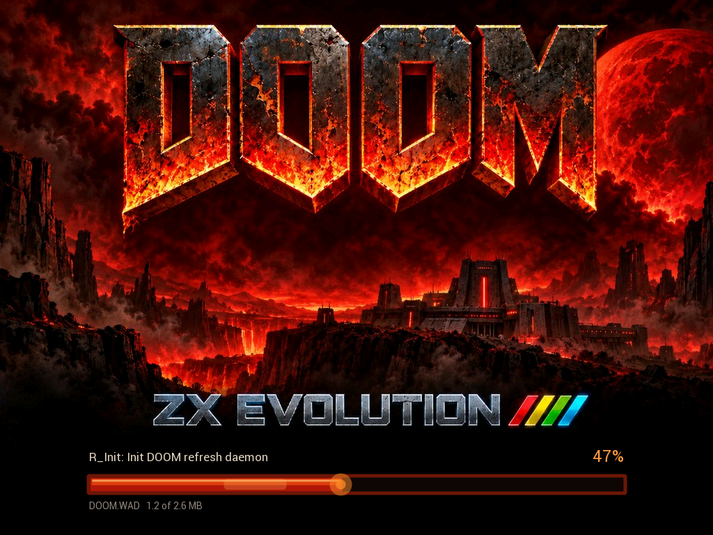

# DOOM для ZX Evolution + VDAC4



Классический DOOM на ZX Evolution (TS-Conf) с платой
[**VDAC4**](https://github.com/andrewinsidelazarev/VDAC4). Основа — порт
[**doomgeneric**](https://github.com/ozkl/doomgeneric).

Игра выполняется на ESP32-S3 платы VDAC4, изображение 1024×768 выводит FT812 на Tang Nano 20K.
Evo читает WAD с SD-карты и передаёт клавиатуру, мышь и джойстик. Игра ничего не перепрошивает:
DOOM.ELF — обычное приложение для прошивки ESP VDAC4.

## Возможности

- DOOM shareware, DOOM / Ultimate DOOM и DOOM II — нужен только свой WAD-файл.
- Меню выбора игры, если в папке несколько WAD.
- Экран 1024×768, картинка 4:3 со сглаживанием или с чёткими пикселями.
- Звуковые эффекты и музыка, стерео 22 кГц.
- Клавиатура PS/2, мышь и джойстик Kempston.
- Сохранения игры и настройки на SD-карте; настройки записываются сами.
- Экран загрузки с картинкой и полосой прогресса.

## Что нужно

| | |
|---|---|
| ZX Evolution | конфигурация TS-Conf, клавиатура PS/2, SD-карта FAT32 в SD-ZC |
| VDAC4 | ESP32-S3 Zero N8R8 с прошивкой VDAC4 **0.1.83** или новее; Tang Nano 20K с ядром FT812 в Slot1 |
| WAD | свой файл игры: **DOOM1.WAD** (shareware), **DOOM.WAD** (DOOM / Ultimate DOOM) или **DOOM2.WAD** |

Прошивки и ядро Tang — в проекте [VDAC4](https://github.com/andrewinsidelazarev/VDAC4).
Сглаживание картинки требует ядра FT812 1.26 или новее. WAD-файлы в пакет не входят.

## Установка

1. Скачайте `DOOM-VDAC4-1.1.zip` со страницы
   [Releases](https://github.com/andrewinsidelazarev/DOOM-VDAC4/releases).
2. Скопируйте `_DOOM.SPG` и `DOOM.ELF` в любую папку на SD-карте, например `\GAMES\DOOM\`.
3. Положите в эту же папку свой WAD-файл (можно несколько).
4. Запустите `_DOOM.SPG`.

Загрузчик сам находит папку с игрой и запоминает её в ESP: следующие запуски начинаются сразу.
В корень карты ничего класть не нужно. Если папок с игрой на карте несколько, берётся первая
найденная — лучше держать одну.

`_DOOM.SPG` и `DOOM.ELF` обновляйте вместе, из одного выпуска.

Загрузка WAD идёт с SD-карты Evo: DOOM1.WAD — около минуты, DOOM2.WAD — 4–5 минут.

## Выбор игры

Если в папке несколько WAD, на экране загрузки появляется меню: DOOM, DOOM SHAREWARE, DOOM II —
только те, что есть в папке.

| Клавиши | Действие |
|---|---|
| 1, 2, 3 | сразу запустить игру с этим номером |
| ↑ ↓ (← →), W / S | выбрать |
| Enter, пробел | запустить |
| Джойстик Kempston | вверх / вниз — выбор, огонь — запуск |

## Управление

| Клавиши PS/2 | Действие |
|---|---|
| Стрелки / W, A, S, D | ход и поворот; навигация по меню |
| Q / E или запятая / точка | шаг влево / вправо |
| Ctrl или F | огонь |
| Пробел | открыть дверь, нажать кнопку |
| Shift | бег |
| Alt | стрейф |
| Esc / Backspace / Enter | меню / назад / выбрать |
| F2 / F3 | сохранить / загрузить |
| F6 / F9 | быстро сохранить / загрузить |
| F4 | громкость эффектов и музыки |
| Tab или M | карта |
| P | пауза |
| 1…7 | оружие |

| Мышь Kempston | Действие |
|---|---|
| Движение | поворот и ход |
| Левая / правая / средняя кнопка | огонь / стрейф / вперёд |

Джойстик Kempston: направления — ход и поворот, кнопка — огонь.

Выход — **Quit Game** в меню или Reset Evo.

## Сохранения и настройки

Всё хранится в папке игры:

| Файл | Что в нём |
|---|---|
| `D1SAVE0.DSG` … `D1SAVE5.DSG` | сохранения DOOM1.WAD |
| `DUSAVE0.DSG` … `DUSAVE5.DSG` | сохранения DOOM.WAD |
| `D2SAVE0.DSG` … `D2SAVE5.DSG` | сохранения DOOM2.WAD |
| `DEFAULT.CFG` | настройки меню, клавиши, громкость |
| `DOOM.CFG` | настройки экрана и мыши |

Настройки записываются сами: изменения в **Options** и **Sound Volume** — при выходе с этого
экрана, горячие клавиши (`-` / `=`, F5, F8, F11) — через секунду. Перед Reset подождите пару
секунд после изменения настроек, чтобы запись успела закончиться.

Файлы настроек — текст «имя значение», их можно править на ПК. Полезные ключи `DOOM.CFG`:

| Ключ | По умолчанию | Значение |
|---|---|---|
| `vdac4_bilinear` | 1 | 1 — сглаживание, 0 — чёткие пиксели |
| `vdac4_mouse_scale` | 16 | множитель скорости мыши |
| `novert` | 0 | 1 — мышь не двигает вперёд-назад |

Скорость мыши удобнее менять в меню: **Options → Mouse sensitivity**.

## Если что-то не так

| На экране | Что делать |
|---|---|
| `FILE NOT FOUND: DOOM.ELF` | положить `DOOM.ELF` в папку с `_DOOM.SPG` и WAD |
| `FILE NOT FOUND: WAD BESIDE ELF` | положить WAD-файл в папку с `DOOM.ELF` |
| `SD CARD INIT FAILED`, `FAT32 MOUNT FAILED` | проверить карту: SD-ZC, файловая система FAT32 |
| `CANNOT STOP PREVIOUS APP` | выключить и включить Evo |
| чёрный экран сразу после запуска | подождать: переключение Tang на FT812 занимает до 15 секунд |

## Ограничения

- Рендер программный, на ESP32: 20–30 кадров в секунду.
- Музыка — встроенный FM-синтезатор, звучит иначе, чем оригинал.
- Нет сети, PWAD и DeHackEd.
- DOOM II целиком не пройден: на больших уровнях может не хватить памяти.
- Без Tang Nano 20K с ядром FT812 игра не запускается.

## Сборка из исходников

Нужны ESP-IDF 6, исходники [VDAC4](https://github.com/andrewinsidelazarev/VDAC4) (ABI и загрузчик
ELF), sjasmplus, spgbld и Python.

```powershell
.\tools\build.ps1 -Vdac4 путь\к\VDAC4
```

Результат — `dist/DOOM/_DOOM.SPG` и `dist/DOOM/DOOM.ELF`. Пути к ESP-IDF и инструментам Z80
задаются в начале `tools/build.ps1`. Проверка загрузчика Z80 на модели — `tests/test_launcher.py`
(нужен пакет Python `z80`), проверка пакета — `tests/test_package.py`.

## Лицензия

Код порта и движок — GPL-2.0-or-later ([LICENSE](LICENSE)). Драйвер
[FAT32 для ZX Evolution](https://github.com/andrewinsidelazarev/FAT32-Driver-ZX-Evolution) — MIT.
Состав и источники — [THIRD_PARTY.md](THIRD_PARTY.md). WAD-файлы принадлежат id Software
и в репозиторий не входят.
